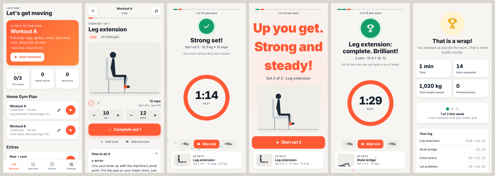

# RepUp: home-gym workouts

A simple, encouraging workout app for your phone. You pick a workout, tick off each set and get cheered on. It counts down your rest and calls you back for the next set.



It's a web app (PWA): no app store and no build step. Open it in your phone's browser and add it to your home screen, and it runs full-screen like a normal app. It also works offline.

## What it does

- **Cheers you on.** Finishing a set gets you a chime, confetti and a line of praise. Finishing an exercise or a whole workout gets you a bigger celebration. It also shows a *Personal best* when you lift your heaviest weight yet, plus a *Halfway there* message and a *Last set, finish strong* nudge.
- **Rest timer.** After each set a countdown ring starts, using the rest time set for that exercise. It beeps for the last 3 seconds, then says *Let's go!* with a big button for the next set. You can add or take off 15 seconds, or skip the rest. When an exercise is finished you get a longer rest, with a preview of the next exercise.
- **Sets, reps and weight.** Use + and − (or tap the number to type it) to log the weight in kg, the resistance level (rowing machine) or the reps for each set. Timed moves like the plank and the rower have a hold timer.
- **Records and PRs.** The app tracks your best weight, highest resistance level, most reps at each weight and longest hold for every exercise. Beat one and you get a gold *Personal record* celebration (e.g. `Leg extension: 10 → 15 kg` or `12 → 13 reps at 15 kg`) with its own fanfare and extra confetti. There are smaller cheers for going heavier than last time (*Progress*), for stepping the weight up between sets, and for each extra PR in the same session (*PR number 3 today!*). As you raise the weight, a *PR attempt!* badge appears before you even start the set. The summary lists every record you broke and compares your total weight moved with last time. History has a *Personal records* list for all your exercises.
- **Repeat past workouts.** In History (or under *Do it again* on the home screen), tap ↻ on any past session. You get the same exercises, in the same order, with the weights you used that day. Raise the weight, resistance, time or sets for each exercise, or use **Level up everything** to add one step to all of them, then start.
- **Remembers last time.** It shows your last result (e.g. `Last time: 20 × 12, 12`). If you hit the top of the rep range on every set, it suggests moving up one weight step.
- **How to do each exercise.** Each exercise has an animated illustration that moves at the 2-seconds-up, 3-seconds-down tempo, plus *Setup / Do / Avoid / Tip* instructions and a breathing reminder.
- **Your equipment.** Turn on the equipment you own (IG-1, rowing machine, dumbbells, chair/bench). The library and workouts show what each exercise needs.
- **Build your own workouts.** Pick exercises (filter by body area), drag to reorder, and set sets, reps, rest and starting weight for each one. You can also create your own exercises.
- **Your plan built in.** *Workout A* and *Workout B* from the Home Gym Plan (IG-1) come pre-loaded, along with the warm-up checklist. The home screen suggests whichever one is next in the rotation. There are also a few extra workouts: *Row + core*, *IG-1 upper body* and *Dumbbell full body*.
- **History.** Every session is logged in the plan's format (`20 × 12, 12`), with a weekly goal (default 3 workouts) and a week streak.
- **Spotify.** Control your music without leaving the app (see below).
- Keeps the screen on during a workout, supports dark mode, and has an optional voice that reads the praise aloud.

## Put it on your phone (free, with GitHub Pages)

1. On GitHub open this repository and go to **Settings → Pages**.
2. Under *Build and deployment*, choose **Deploy from a branch**. Pick the branch with this code and the `/ (root)` folder, then **Save**.
3. After a minute your app is live at `https://<your-username>.github.io/work-out/`.
4. Open that link on your phone:
   - **iPhone (Safari):** Share → **Add to Home Screen**.
   - **Android (Chrome):** ⋮ menu → **Add to Home screen** / **Install app**.

Your workouts and history are saved on the phone itself. To move them to another device, use **Settings → Export backup / Import backup**.

## Spotify

There are two options, both in **Settings → Music**.

**1. Playlist player (easy).** Paste a Spotify playlist or album link (Share → Copy link in Spotify). A Spotify player then sits at the bottom of the workout screen. Tap the ♫ button to expand it to the full track list. You get full songs if you're logged in to Spotify in that browser, and 30-second previews otherwise.

**2. Remote control for the Spotify app (Spotify Premium).** This shows the song playing in your Spotify app, with play, pause and skip buttons on the workout screen. It takes a one-time setup:

1. Go to <https://developer.spotify.com/dashboard>, log in and **Create app**. Tick **Web API**.
2. Add the **Redirect URI** that the app shows in Settings. It's the app's own address, e.g. `https://<your-username>.github.io/work-out/`.
3. Paste the app's **Client ID** into Settings and tap **Connect Spotify**.

The Spotify sign-in uses PKCE, so no secret key is needed or stored. Spotify only lets the Web API control playback on Premium accounts.

## Running it locally

It's plain HTML, CSS and JavaScript modules, so any static web server will do:

```sh
python3 -m http.server 8000
# then open http://localhost:8000
```

## Project layout

```
index.html            app shell
css/app.css           styles (light + dark)
js/app.js             screens, workout player, rest timer, builder, settings
js/data.js            exercises, instructions, illustrations, starter workouts
js/figure.js          animated stick-figure renderer
js/fx.js              praise lines, sounds, vibration, voice, confetti, screen wake lock
js/spotify.js         Spotify embed + remote control
js/store.js           saving to the device, history helpers
sw.js                 offline support
```

### Adding an exercise to the built-in library

Add an entry to `EXERCISES` in `js/data.js`. The illustration (`fig`) is a list of poses for a side-on stick figure facing right. Each pose gives the hip position, the torso angle (`t`) and either limb angles (`ua`/`fa` for the arm, `th`/`sh` for the leg) or a target point for the hand or ankle (`hand`, `ankle`), which is solved automatically. Angles are in degrees: 0 is right, 90 is down and −90 is up. `scene` adds equipment such as pulleys, cables, pads and benches.

## Safety

The app includes the plan's stop signs (Settings → Stop signs). Stop if you feel dizzy, light-headed, shaky, nauseous, or have chest pain or unusual stomach pain, and check in with your medical team.
